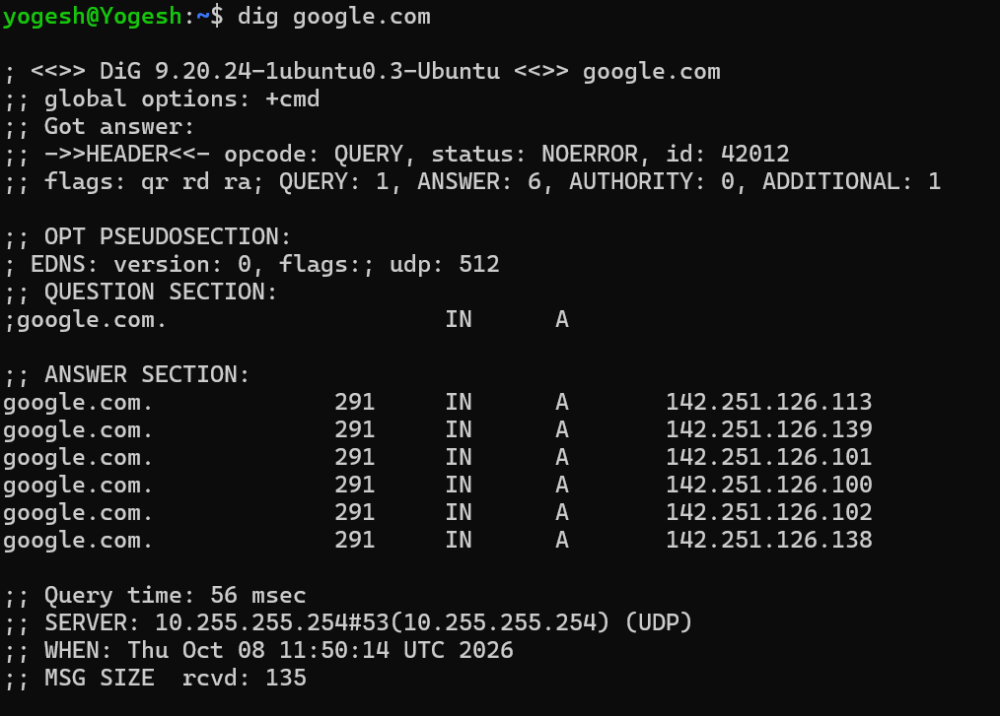
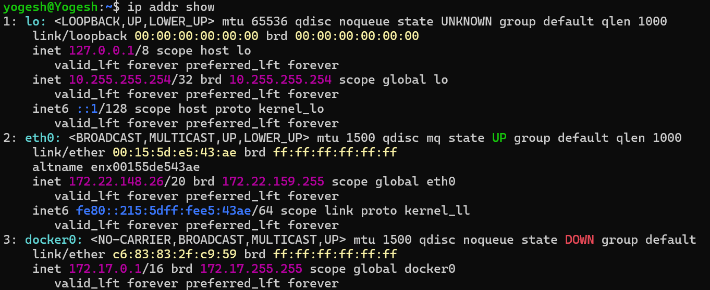
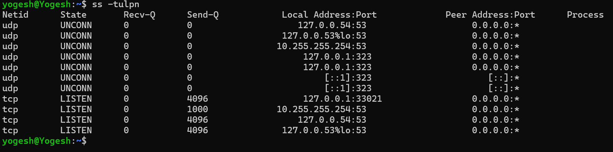

Explain in 3–4 lines: what happens when you type google.com in a browser?

ANS:- first the browser checks the internal cache if the google.com is present. if not then browser ask local os, and router to check their local DNS cache. if there also not present the request goes to isp dns recursive resolver. the resolver then queries root server which points out to tld server (.com) which then points out to google names server and fetches the ip address.

What are these record types? Write one line each:
A, AAAA, CNAME, MX, NS

• A: Maps a domain name directly to an IPv4 address (a 32-bit numerical label like 192.0.2.1).
• AAAA: Maps a domain name directly to an IPv6 address (a newer, longer 128-bit numerical label).
• CNAME: Aliases one domain name to another domain name, pointing a subdomain to a root domain or external host.
• MX: Specifies the mail servers responsible for receiving emails on behalf of the domain.
• NS: Identifies the authoritative name servers that store and manage all the DNS records for the domain.

Run: dig google.com — identify the A record and TTL from the output

All the records are [A] record and 291 is the ttl

What is an IPv4 address? How is it structured? (e.g., 192.168.1.10)

ANS:- IPv4 address 32 bit unique address assigned to the device connected to the network.it is grouped into 4 sections. each section is of 8 bytes in the format of 0 and 1. 

Difference between public and private IPs — give one example of each.
ANS:- public IP(142.250.190.46) are the public facing ip which means it communicate with public internet. which private ip(192.168.1.1) are isolated ip which communicates within the local network. 

What are the private IP ranges?
ANS:- • 0.0.0.0 – 10.255.255.255 (10.0.0.0/8) – Used for large enterprise networks.
• 172.16.0.0 – 172.31.255.255 (172.16.0.0/12) – Used for medium-sized networks.
• 192.168.0.0 – 192.168.255.255 (192.168.0.0/16) – Used for home and small office networks.

Run: ip addr show — identify which of your IPs are private

172.22.159.255 and 172.17.255.255 IP are private IP.

What does /24 mean in 192.168.1.0/24

ANS:-  the number /24 means the 24 bits belogs to the network prefix.

How many usable hosts in a /24? A /16? A /28?

ANS:- for /24 254  usable host are there. for /16 65,534 usable host. for /28 there are 14 usable host.

Explain in your own words: why do we subnet?

ANS:- we need subnet to divide the IP into logical sub network which will use all the potential of IPv4

<table border="1" cellpadding="5" cellspacing="0" style="border-collapse: collapse; text-align: center;">
  <thead>
    <tr style="background-color: #f2f2f2;">
      <th>CIDR</th>
      <th>Subnet Mask</th>
      <th>Total IPs</th>
      <th>Usable Hosts</th>
    </tr>
  </thead>
  <tbody>
    <tr>
      <td><strong>/24</strong></td>
      <td>255.255.255.0</td>
      <td>256</td>
      <td>254</td>
    </tr>
    <tr>
      <td><strong>/16</strong></td>
      <td>255.255.0.0</td>
      <td>65,536</td>
      <td>65,534</td>
    </tr>
    <tr>
      <td><strong>/28</strong></td>
      <td>255.255.255.240</td>
      <td>16</td>
      <td>14</td>
    </tr>
  </tbody>
</table>

What is a port? Why do we need them?

ANS:- A port is a digital mailbox number on your computer that directs specific internet traffic to the right app. We need them so a computer can run multiple internet activities at once—like browsing the web and streaming music—without mixing up the data.

2. Document these common ports:

| Port | Service |
|------|---------|
| 22   | ssh     |
| 80   | http    |
| 443  | https   |
| 53   | DNS     |
| 3306 | sql     |
| 6379 | Resis   |
| 27017| mongodb |

3. Run `ss -tulpn` — match at least 2 listening ports to their services

ANS:- 

 
 port 53 - DNS
 port 323- chronyd

 - You run `curl http://myapp.com:8080` — what networking concepts from today are involved?
 ANS:- the concept of port and DNS is involved in this scenario.

 - Your app can't reach a database at `10.0.1.50:3306` — what would you check first?
 ANS:- I will check if the mysql service is running and listening on port 3306.
