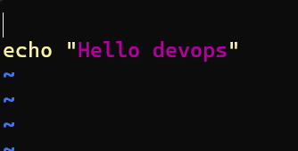
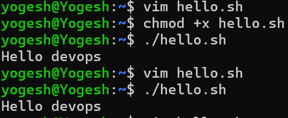
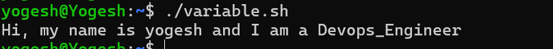
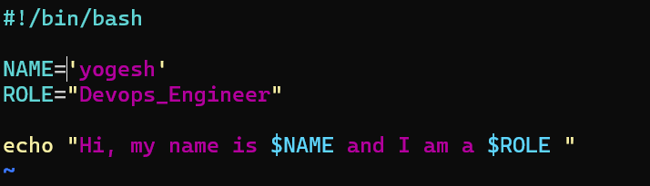
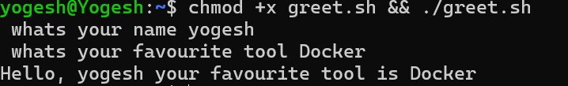
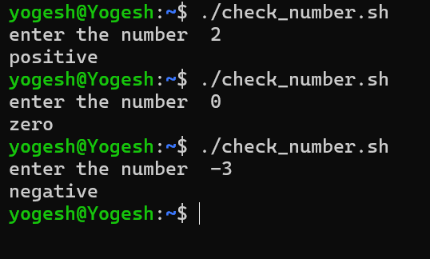
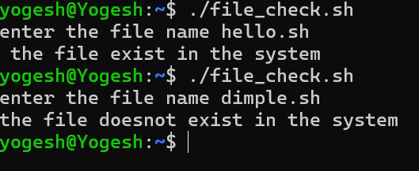
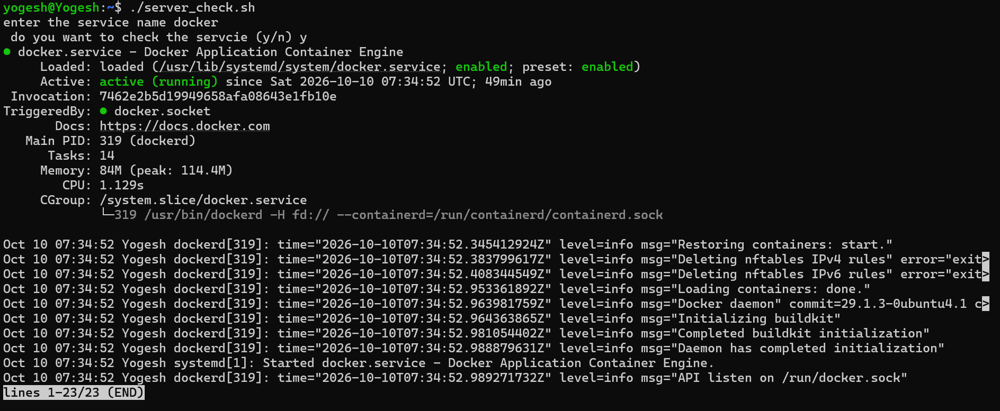

- What happens if you remove the shebang line?
ANS:- the hello.sh still runs sucessfully.

Try using single quotes vs double quotes — what's the difference?

there is no difference observed

TASK 3:
- 

TASK 4:
1. 
2. 

TASK 5:

