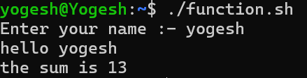
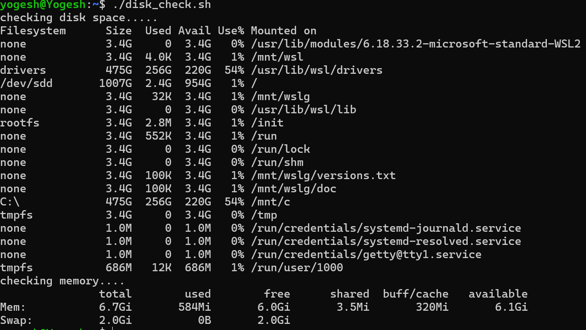
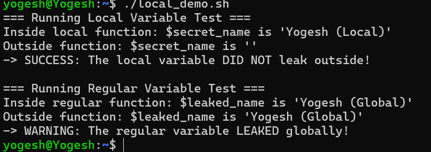

# task 1


# task 2


# task 3

### Try using an undefined variable — what happens with set -u?

#### with set -u if there is any undefined variable then the script will crash 

### Try a command that fails — what happens with set -e?

#### with set -e exit the script if any error is encountered.

### Try a piped command where one part fails — what happens with set -o pipefail

#### when any command in the pipe fails, the entire pipe fails and it will return set -e

# task 4


# task 5 output
```bash
yogesh@Yogesh:~$ ./system_info.sh
the hostname is :-
Yogesh
=======
OS-INFO
=======

PRETTY_NAME="Ubuntu 26.04 LTS"
NAME="Ubuntu"
VERSION_ID="26.04"
VERSION="26.04 (Resolute Raccoon)"
VERSION_CODENAME=resolute
ID=ubuntu
ID_LIKE=debian
HOME_URL="https://www.ubuntu.com/"
SUPPORT_URL="https://help.ubuntu.com/"
BUG_REPORT_URL="https://bugs.launchpad.net/ubuntu/"
PRIVACY_POLICY_URL="https://www.ubuntu.com/legal/terms-and-policies/privacy-policy"
UBUNTU_CODENAME=resolute
LOGO=ubuntu-logo

=======
uptime
=======

 14:15:11 up  4:31,  1 user,  load average: 0.02, 0.06, 0.02
==========
disk usage
==========

[sudo: authenticate] Password:
248K    task
232K    devops-git-practice
16K     scripts
12K     heist-project
4.0K    variable.sh
======
memory
======

               total        used        free      shared  buff/cache   available
Mem:           6.7Gi       642Mi       5.9Gi       3.5Mi       277Mi       6.1Gi
Swap:          2.0Gi          0B       2.0Gi
=============================
top 5 CPU-consuming processes
=============================

USER         PID %CPU %MEM    VSZ   RSS TTY      STAT START   TIME COMMAND
yogesh      7337  100  0.0   7164  4320 pts/0    R+   14:15   0:00 ps aux --sort=-%cpu
root          88  0.2  0.1  35120 12304 ?        Ss   09:44   0:46 /usr/lib/systemd/systemd-udevd
root         285  0.2  0.6 2088664 44784 ?       Ssl  09:44   0:42 /usr/bin/containerd
polkitd     6583  0.0  0.1 306444  8320 ?        Ssl  14:08   0:00 /usr/lib/polkit-1/polkitd --no-debug --log-level=notice
root         341  0.0  1.0 2277244 72020 ?       Ssl  09:44   0:03 /usr/bin/dockerd -H fd:// --containerd=/run/containerd/containerd.sock
````