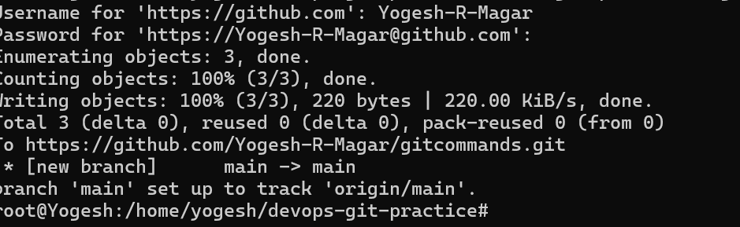
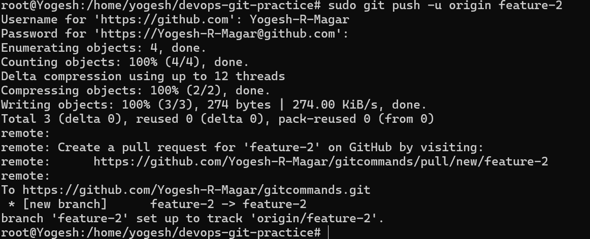

What is a branch in Git? 
ANS:- Branch is a isolation where the devloper can experiment, test or add new features without disrupting the main source code.  
Why do we use branches instead of committing everything to main? 
ANS:- the code in the main branch is the production code.If we directly commit in the main branch, there can be the production failure if the code commited on main branch is faulty. Due to this there can be downtime face. We need to create a bracnh which enable isolation and we can also experiment with the code without facing downtime.  
What is HEAD in Git? 
ANS:-Head is the reference point in the git history.  
What happens to your files when you switch branches? 
ANS:- when your file is untracked no matter you changed the branch you files will be on directory. when files are commited git will match the commit and disappear the file from other branch. when you add the file into stage area and change the branch then that file will be added into stage of that branch also.

# What is the difference between origin and upstream?
## ANS:-origin and upstream are the alias of each other when you own the repo its origin and when the repo is owned by other its alias. In alias you cannot push changes into the repo, you need to create the pull request.

# What is the difference between git fetch and git pull?
## ANS:- git fetch downloads the changes to local repo whereas git pull downloads changes to local and also merges with local repo.

# What is the difference between clone and fork?
## ANS:- When you clone the github repo the copy of that repo is downloaded to your local machine. fork is similar to clone but it creates the copy in your github repo.

# When would you clone vs fork?
## You should clone the repo when you have permission to directly make changes into that repo. you should fork repo when you don't have direct permission to make changes into that repo. 

# After forking, how do you keep your fork in sync with the original repo?
## ANS:- by using git remote add upstream < creators repo link>
